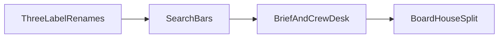

# Features + 3 tab renames

## Scope locked

**Rename only these three labels** (route keys unchanged):

- `Recipes & prep` → **Recipes** (`recipes`)
- `Bulk & catering` → **Bulk** (`bulk`)
- `Plan & billing` → **Plan** (`billing`)

**Do not** rename Counter/Front, Kitchen/Line, Stock/Pantry, Owner/Pulse, Reports/Books, Offers/Boost, etc.

**Feature-driven names** (part of the feature work, not the “3 keeps”):

- Today → **Brief**; new **Crew desk**
- Menu & settings → **Board**; cafe block → **House**
- Suppliers → **Intake** (search feature)
- **TableTurn stays TableTurn** (add name/phone search only; do not rename to Floor)

## Implementation order

### 1. Three label renames (small)

- [server/public/js/app.js](C:/Users/Joshua%20Selvam/Documents/Mydoc/sample-project/DVibes/ordernest-pos/Ordernest-pos-AI/server/public/js/app.js) `SCREENS` labels for `recipes`, `bulk`, `billing`
- Matching `<h1>` text in `recipes.js`, `bulk.js`, `billing.js`
- Sweep help/setup strings that say “Recipes & prep” / “Bulk & catering” / “Plan & billing” only where user-facing

### 2. Search bars

- **Board** ([menu.js](C:/Users/Joshua%20Selvam/Documents/Mydoc/sample-project/DVibes/ordernest-pos/Ordernest-pos-AI/server/public/js/views/menu.js)): filter items by name/category (same pattern as Stock `stQ`)
- **Intake** ([purchases.js](C:/Users/Joshua%20Selvam/Documents/Mydoc/sample-project/DVibes/ordernest-pos/Ordernest-pos-AI/server/public/js/views/purchases.js)): keep invoice search; show same search on Suppliers + Drafts tabs; label tab **Intake**
- **Recipes** ([recipes.js](C:/Users/Joshua%20Selvam/Documents/Mydoc/sample-project/DVibes/ordernest-pos/Ordernest-pos-AI/server/public/js/views/recipes.js)): filter recipe list by name
- **TableTurn** ([tableturn.js](C:/Users/Joshua%20Selvam/Documents/Mydoc/sample-project/DVibes/ordernest-pos/Ordernest-pos-AI/server/public/js/views/tableturn.js)): name/phone filter on bookings + waiting; **keep label TableTurn**

### 3. Brief + Crew desk (core feature)

**Brief** (evolve Today):

- Rename label/H1 Today → Brief in `app.js` + [today.js](C:/Users/Joshua%20Selvam/Documents/Mydoc/sample-project/DVibes/ordernest-pos/Ordernest-pos-AI/server/public/js/views/today.js)
- Keep clock-in + open tasks; cards leave on Done / Can’t / Got it
- Extend [work-tasks.js](C:/Users/Joshua%20Selvam/Documents/Mydoc/sample-project/DVibes/ordernest-pos/Ordernest-pos-AI/server/src/work-tasks.js) + new migration: allow `kind` `cook` | `chore` | `notice` (drop cook-only check in [060_work_tasks.sql](C:/Users/Joshua%20Selvam/Documents/Mydoc/sample-project/DVibes/ordernest-pos/Ordernest-pos-AI/server/migrations/060_work_tasks.sql) via new `067_…sql`)
- `/api/today` returns all open assigned kinds; notice dismiss = done/ack
- Do **not** merge TableTurn clean-up into Brief

**Crew desk** (new view + bar entry for owner/manager):

- New `views/crew.js`; register in `SCREENS` / role maps
- People + PIN/job (move UI from menu Team panel)
- Assign Ask cook / Assign chore; send short notice to person or cafe
- Manager hours/wages from attendance folded in (Attendance bar tab removed for roles that get Crew desk; staff clock stays on Brief)
- Move “Ask chef” create flow from recipes into Crew desk (recipes may keep a deep-link “Assign” that opens Crew desk)

### 4. Split Board / House

- **Board** (`menu`): items/prices/options/recipes-on-item + search only; label **Board**
- **House** (new screen or `#house` section): cafe profile, tax, pay, delivery toggles, kiosk key, languages, delete account — moved off menu.js
- Update setup deep links in [setup.js](C:/Users/Joshua%20Selvam/Documents/Mydoc/sample-project/DVibes/ordernest-pos/Ordernest-pos-AI/server/public/js/setup.js) (`#menu/cafe` → `#house/…`, team → `#crew`)
- Owner/manager role maps: add `house`, `crew`; drop standalone `attendance` where Crew desk covers it

### 5. Verify

- `cd server && npm test` (work-tasks + public-js-syntax + any new inject tests)
- Smoke: Brief cards clear; Crew assign appears on Brief; Board search; Intake search all tabs; TableTurn search; three short labels

## Out of scope

Full rename map (Front, Line, Float, Pantry, Boost, Pulse, Books, Floor); renaming TableTurn; Channels/Reports hygiene; phone push; merging TableTurn clean-up with Brief.